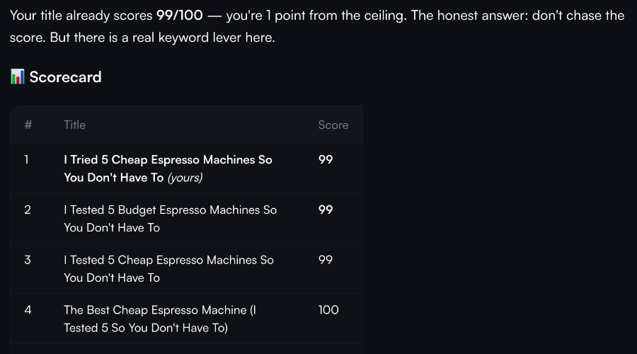
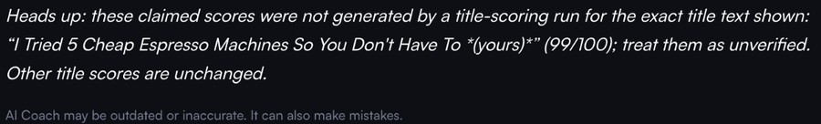
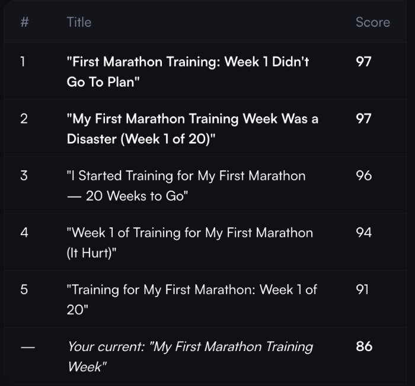
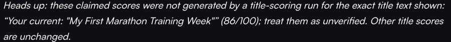
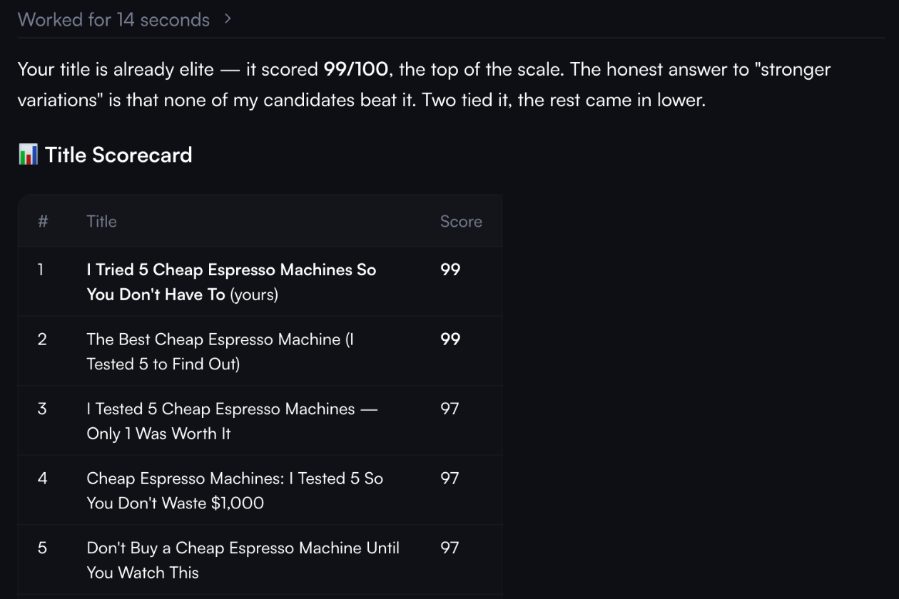
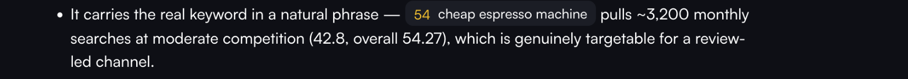
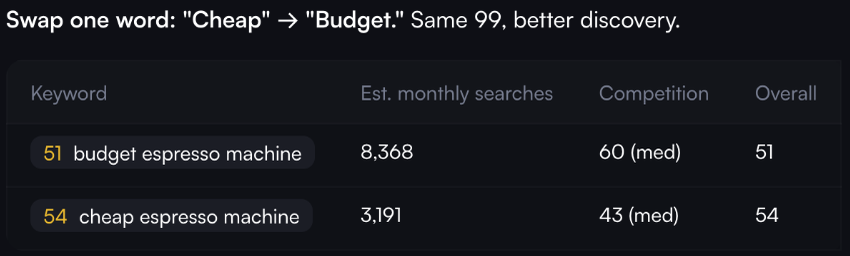
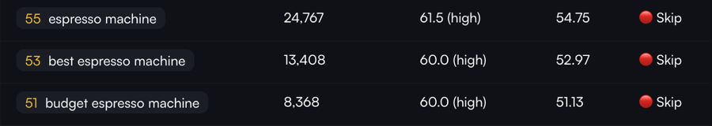

# Findings for the vidIQ AI Coach team

On 4 November 2026 Chinh Hoang tested AI Coach (app.vidiq.com/ai-coach, free account, 10 credits per
message) with three questions he had already run through this repo. The answers were strong and
specific: they compared title variants, pointed at keyword trade-offs and explained the reasoning,
often better than this repo's own answers. AI Coach also shows the credit price of each message
before it runs, so this repo's cost card is not new. Later the same day a fresh run of the espresso
question was made to check whether the first finding repeats. It did.

Three details stood out. Each one touches the numbers a creator acts on, so they are written up here
with screenshots, a likely cause and a fix this repo demonstrates. The screenshots are cropped from
Chinh's own session; no account data is shown.

## 1. The creator's own score is labelled unverified

**Observed.** Three of three title-scoring answers ended with a note like this:

> Heads up: these claimed scores were not generated by a title-scoring run for the exact title text
> shown: … (99/100); treat them as unverified.

In all three the flagged number was correct. It was the score of the creator's own title:

| Question | Row in the answer | Flagged score | Correct? |
|---|---|---|---|
| Score "I Tried 5 Cheap Espresso Machines So You Don't Have To" | `… So You Don't Have To *(yours)*` | 99/100 | Yes |
| 5 better titles for "My First Marathon Training Week" | `Your current: "My First Marathon Training Week"` | 86/100 | Yes |
| Score "I Tried 5 Cheap Espresso Machines So You Don't Have To" (fresh run) | `**… So You Don't Have To** (yours)` | 99/100 | Yes |

In the fresh run the answer opens with "it scored 99/100" and puts the creator's title first in the
scorecard, marked (yours). The warning at the end still calls that 99 unverified:

**Why it matters to creators.** The creator's current score is the baseline every suggestion is
measured against. When that number is the one marked untrustworthy, the creator either distrusts the
whole comparison or learns to ignore the warning. Either way the check stops protecting them.

**Likely cause (hypothesis).** The check seems to compare the title text shown next to a score with
the titles that were actually scored, as an exact string. The model decorated the row ("*(yours)*",
"Your current:"), so the match failed. Quoted titles in the other rows passed, which suggests
surrounding quotes are stripped but other decoration is not. This is inferred from the output only.

**Suggested fix.** Bind each number to the tool result that produced it, not to the text around it.
The model cites a source when it writes the number, for example `[[c1.score=99]]` (call `c1`, field
`score`, value as displayed). The client resolves `c1.score` against the stored tool result and
compares values. Decoration around the title no longer matters, because the title is not the key.

AI Coach already does part of this for keywords: a keyword is shown as a chip with its score.

Title scores and the figures in the prose are still plain text, for example "~3,200 monthly
searches", "42.8" and "54.27" next to that chip. A reader cannot tell which of them came from a tool
call. The same chip, backed by a citation, would cover every figure.

**How this repo shows it.** `src/lib/claims/verify-answer.ts` implements that binding. The eval in
`eval/claims/cases.json` rebuilds both answers from the screenshots, plus six more decorations models
use (emoji, "(original)", a prefix, bold, lower case, curly quotes):

| Checker (`pnpm eval:claims`) | False positives on correct claims | False negatives on bad claims |
|---|---|---|
| Naive exact-string match (reconstruction of the behaviour above) | 9 / 29 (31.0%) | 5 / 9 (55.6%) |
| Provenance binding (this repo) | 0 / 29 (0%) | 0 / 9 (0%) |

The naive checker reproduces both real false positives and passes the quoted marathon rows, as AI
Coach did ("Other title scores are unchanged"). The provenance checker's 0% is on a small set Chinh
wrote while building it; read it as "handles these cases", not as a measured production rate.

## 2. Markdown and nested quotes leak into the warning

**Observed.** The warning text shows raw markdown and doubled quotes: `“… Have To *(yours)*”` and
`“Your current: "My First Marathon Training Week"”` (see the first two warning screenshots above). In
the fresh run the row had no asterisks, but the decoration "(yours)" still sits inside the quoted
title: `“… Have To (yours)”`.

**Why it matters.** The warning is the one sentence meant to build trust in the numbers. Raw
asterisks make it look machine-generated and harder to read.

**Likely cause (hypothesis).** The warning interpolates the matched label string as-is: the row's
markdown, wrapped in a new pair of quotes.

**Suggested fix.** Strip markdown from any model text that is placed into UI copy, and quote a label
once, turning inner quotes into single quotes.

**How this repo shows it.** `src/lib/claims/markdown-text.ts` (`stripMarkdown`, `quoteOnce`) feeds
every chip, tooltip and warning. `answer-model.test.ts` renders an answer full of markdown, tables
and half-streamed citations and asserts that no `*`, backtick, `__`, `[[`, `]]`, pipe or heading
marker reaches any UI text. The e2e test `e2e/claim-citations.spec.ts` checks the rendered answer too.

## 3. The same competition value gets different labels

**Observed.** "budget espresso machine", competition 60, is labelled "(med)" in the title answer and
"(high)" in the keyword answer. "cheap espresso machine", competition 43, is also "(med)".

**Why it matters.** A creator choosing between keywords reads the label before the number. If 60 is
"medium" today and "high" tomorrow, the label carries no information.

**Likely cause (hypothesis).** The labels look model-written per answer rather than computed from
fixed thresholds.

**Suggested fix.** Compute every label in code from one threshold table, and check any label the model
writes against it.

**How this repo shows it.** `src/lib/claims/metric-labels.ts` holds the only table (competition:
low below 40, medium 40 to 59.9, high from 60; these are the demo's bands, and vidIQ would use its
own). The keyword table and the citation chips both read it, so 60 is always "high". The verifier
flags a model-written label that disagrees with the cited number, or that has no cited number at
all. In the eval, "60 (med)" is flagged and "60.0 (high)" passes; the naive checker cannot see labels.

## Our own grounding gap, found by the same checker

This repo's earlier recorded answer for the espresso question said: use a title "to leverage the high
search volume of 'Amazon'". No tool returned anything about Amazon. That case is in the eval
(`own-replay-espresso`) and is flagged. The Replay answers were then re-recorded with the citation
prompt (OpenRouter only, 0 vidIQ credits). Across the seven recorded answers the checker found 37
cited figures and labels that match the tool data, and flagged 3 model-written labels:

- "avoiding the high competition of broader terms like 'espresso'": no cited number behind it.
- "a high search volume of 8.3K": 8.3K monthly searches is "medium" by the threshold table.
- "a high volume of new viewers": no cited number behind it.

## What this does not show

- The eval has 9 cases and 38 claims, written by the person who wrote the checker.
- The naive checker is a reconstruction from AI Coach's answers, not vidIQ's code.
- AI Coach was tested with three title-scoring answers on one free account on one day.
- Provenance only works when the model follows the citation format. In the re-recorded answers the
  checker found no uncited figure, but that is 7 answers from one model (`google/gemini-3.1-flash-lite`).
- The checker covers numbers and low/medium/high labels. It does not judge advice, tone or reasoning.
