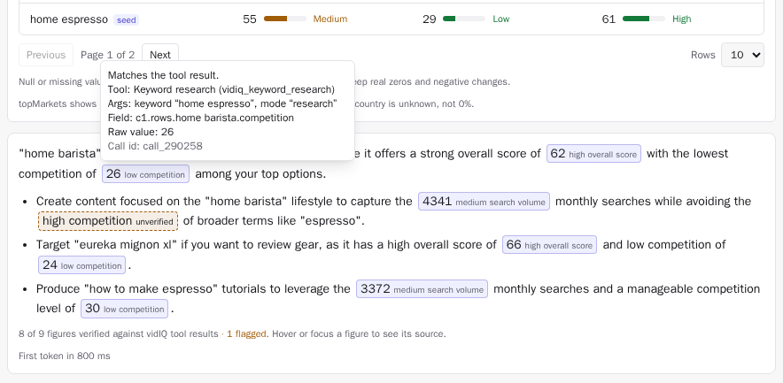
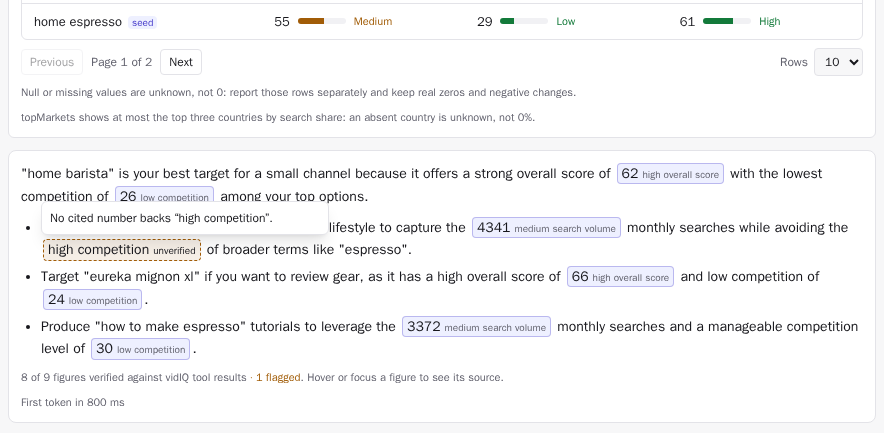

# Creator Copilot: a provenance-based claim checker for LLM answers on vidIQ data

An independent demo built on the public [vidIQ MCP](https://support.vidiq.com/en/articles/15082430-vidiq-mcp).
It is not made or endorsed by vidIQ and uses no vidIQ brand assets.

Chinh Hoang designed it around one question: **can a creator trust each number in an AI answer?**
On 4 Nov 2026 he tested vidIQ's AI Coach with three questions and found that its claim check called
the creator's own correct title score (99/100 and 86/100) "unverified", because the model had written
"*(yours)*" or "Your current:" next to the title. The details, with screenshots, are in
[FINDINGS.md](FINDINGS.md). This repo shows a fix that vidIQ could use now.

## How the claim checker works

1. **The model cites, the client verifies.** The answer prompt numbers each tool result (`c1`, `c2`, …)
   and the model must write every figure as a citation: `[[c1.score=99]]`,
   `[[c1.rows.home barista.competition=26]]`. The browser resolves the path against the stored tool
   result: call id, tool, args, field path and raw value.
2. **Binding is by provenance, not by display text.** How the model decorates a title ("(yours)",
   "Your current:", quotes, markdown) has no effect on the check.
3. **Only three things are flagged:** a figure with no provenance, a figure that disagrees with its
   source value at the precision shown ("8.4K" matches 8,368; "60" does not match 8,368 searches; "60%"
   does not match a 0-100 score), and a low/medium/high label that has no cited number or disagrees
   with it.
4. **Labels come from one table in code.** `src/lib/claims/metric-labels.ts` decides low, medium and high
   for competition, volume, overall score and monthly searches. The keyword table and the answer use it,
   so 60 is always "high competition".
5. **Every figure is a citation chip.** Hover or keyboard focus shows the tool, args, field path, raw
   value and call id; Escape closes it. Unverified figures and labels have a dashed amber border and
   the word "unverified". A line under the answer counts verified and flagged figures. No raw markdown
   reaches any UI text.

| Verified figures, details on focus | A model-written label with nothing behind it |
|---|---|
|  |  |

## Eval: naive exact-string check vs provenance

`pnpm eval:claims` runs offline on `eval/claims/cases.json` (0 credits, $0) and writes
`eval/results/claims-latest.{md,json}`. The cases include the two real false positives rebuilt from
the screenshots, decoration variants, fabricated numbers, wrong numbers, unit mix-ups, the
inconsistent "(med)"/"(high)" label and this repo's own earlier ungrounded answer.

| Checker | False positives (correct claims flagged) | False negatives (bad claims missed) |
|---|---|---|
| Naive exact-string match, a reconstruction of the observed behaviour | 9 / 29 (31.0%) | 5 / 9 (55.6%) |
| Provenance binding (this repo) | 0 / 29 (0%) | 0 / 9 (0%) |

The same command checks the seven Replay answers, re-recorded with the citation prompt: 33 figures and
labels verified, 3 model-written labels flagged (for example "a high search volume of 8.3K", which is
medium by the table). The earlier espresso answer's "high search volume of Amazon" is flagged too.

## Run it locally (one command, no keys)

```bash
corepack pnpm install && corepack pnpm demo
```

Open http://localhost:3000. Replay mode is the default: it plays real vidIQ MCP responses recorded on
4 Nov 2026 and model answers re-recorded the same day, so the demo costs 0 credits and $0.
Node ≥ 22.18; pnpm is pinned through `packageManager`.

Live mode: set `OPENROUTER_API_KEY` on the server (see `.env.example`), switch to **Live**, and paste
your own vidIQ API key. The key stays in `sessionStorage` (this tab only) and is sent only to this
app's `/api/*` routes, which forward it to `https://mcp.vidiq.com/mcp` as a Bearer token.

## How the job description maps to the code

| JD point | Where it is proven |
|---|---|
| TypeScript | Strict mode with `noUncheckedIndexedAccess`; `pnpm typecheck` is clean. Discriminated unions for claim segments (`src/lib/claims/verify-answer.ts`), results (`src/lib/schemas/view-types.ts`) and errors (`src/lib/mcp/mcp-errors.ts`). |
| React | Function components with no UI library. `ClaimChip` (`src/components/claim-chip.tsx`) is a focusable button with an `aria-describedby` tooltip that opens on hover or focus and closes on Escape. Accessible table (`aria-sort`, row headers), meters, live regions. |
| Next.js | App Router 16. Static home page; route handlers in `src/app/api/*` (plan, tool, answer, balance, telemetry); security headers in `next.config.ts`. |
| Tailwind | Tailwind 4 with CSS-variable design tokens for light and dark (`src/app/globals.css`). No webfonts. |
| Zustand | `src/store/copilot-store.ts` (conversation, settings persisted to localStorage) and `src/store/key-store.ts` (vidIQ key in sessionStorage). Orchestration is outside React in `src/lib/copilot/turn-runner.ts`. |
| LLM features, streaming | OpenRouter SSE parsed by `src/lib/stream/read-lines.ts`, re-streamed as NDJSON by `src/app/api/answer/route.ts`. The answer is verified while it streams: a half-written citation is hidden until it closes. |
| Unpredictable model output | The claim checker (`src/lib/claims/`): provenance binding, unit-aware value match, unbacked-figure and label detection, markdown sanitizer. Also `parseStructured()` (ok → local repair → one model repair → typed fallback) and the argument grounding check in `src/lib/llm/grounding.ts`. |
| MCP | Hand-written Streamable HTTP client, protocol 2025-06-18: initialize → `Mcp-Session-Id` → `notifications/initialized` → `tools/call`, JSON or SSE responses, timeouts, error mapping. `src/lib/mcp/mcp-client.ts`. |
| Performance | Budget in `perf/budget.json`, enforced by `pnpm perf`. The checker runs in the browser; this change added 4.5 KB compressed, and initial JS is 152.3 KB of a 170 KB budget. |
| Tests | 129 unit tests (Vitest), written red first at the seams: provenance binding, verifier, label thresholds, markdown sanitizer. 9 Playwright tests, including citation hover, keyboard focus and Escape, and a no-raw-markdown check. |
| Monitoring | `track()` beacons to `/api/telemetry` (tool calls, plan, answer TTFT, schema fallback, web vitals, client errors). No prompts or keys are logged. |

## Architecture

```
browser (Zustand)                         Next.js route handlers                 external
─────────────────                         ──────────────────────                 ────────
prompt ──► /api/plan ───────────────────► planner (OpenRouter, tool calling) ──► OpenRouter
for each call: cost card or cache
Run ─────► /api/tool ───────────────────► allowlist → MCP client ──────────────► mcp.vidiq.com
           ◄─ { result, view }             vidIQ text/JSON → zod → typed view
answer ──► /api/answer (NDJSON stream) ─► evidence numbered c1, c2 … ─────────► OpenRouter
           ◄─ text with [[c1.score=99]]
verifyAnswer(text, sources c1, c2 …) → chips: verified · ≠ source · unverified
```

The browser builds sources from the same steps, in the same order, with the same skip rule as the
server (`src/lib/copilot/answer-sources.ts`, `src/lib/llm/answer.ts`). Replay mode swaps only the
external boxes for recordings in `src/fixtures/replay/`.

## Credit protection (secondary)

The copilot still guards credits, but AI Coach already shows a per-message price, so this part is
not new. A compact cost card shows the tool, the credits and the balance after, then waits for
*Run* or *Skip* (auto-run under a session cap is optional). Identical calls come from cache
("0 credits, cached"). Paid calls are never retried on their own. A server-side read-only allowlist
refuses generation, upload, media, bookmark and competitor tools. Quoted titles in the planner's
arguments must be copied verbatim, so a paraphrased title is not scored for 5 credits.

## Other evals and performance

`pnpm eval` runs the planner eval offline; `pnpm eval --live` uses the real planner. Latest live run,
made before the citation prompt (`eval/results/latest-live.json`, model `google/gemini-3.1-flash-lite`): tool choice 14 / 14, schema-valid
arguments 100%, answer TTFT median 793 ms, malformed-output suite 3 ok, 4 repaired, 3 typed fallback,
0 crashes.

`pnpm perf` (production build, median of 3 runs, `perf/latest.json`):

| Profile | LCP | CLS | Initial JS (compressed) | Budget |
|---|---|---|---|---|
| Desktop | 84 ms | 0 | 152.3 KB | LCP ≤ 1000 ms, JS ≤ 170 KB |
| Mobile, 375 px, 4× CPU, Slow-4G-like network | 472 ms | 0 | 152.3 KB | LCP ≤ 2500 ms |

## Credits and spend

Recording the vidIQ fixtures cost 40 credits (170 → 130). The claim checker work spent 0 vidIQ
credits: the eval is offline, and the Replay answers were re-recorded from the stored tool results
through OpenRouter for $0.0040 in total.

## How it would roll out at vidIQ

1. **Baseline.** Log, per answer, how many figures the current check marks unverified and how often
   the marked figure is the creator's own title. Sample marked answers and label them by hand to get
   the current false-positive rate.
2. **Shadow.** Ask the model for citations and run the provenance checker on real traffic without
   changing the UI. Track citation compliance (figures with a valid citation / figures shown) and
   compare both checkers on the hand-labelled sample. The gate needs compliance ≥ 98% and a lower
   false-positive rate with no rise in missed fabrications.
3. **Gate.** Show citation chips and the new warning behind a flag for 5% of creators, then 25% and
   100%. Guardrails: thumbs-down rate does not rise, answer length and TTFT stay within 5%, and
   support tickets about wrong numbers fall.
4. **Kill switch.** Remote flags for the chips and for the warning. A citation that cannot be read is
   shown as its value marked unverified, never as raw brackets; the checker never blocks an answer.

## What this repo does not prove

- No real users. The flows are tested, but nobody has used them to grow a channel.
- The claim eval has 9 cases and 38 claims, written by the same person who wrote the checker. 0% is
  "handles these cases", not a production rate.
- The naive checker is a reconstruction from three AI Coach answers, not vidIQ's code.
- Citation compliance is measured on 7 answers from one model. Another model may cite less reliably.
- The checker covers figures and low/medium/high labels. It does not judge advice or reasoning, and
  bare numbers are found with word and column-header cues, so an unusual phrasing can slip past.
- The label bands are this demo's choice; vidIQ would use its own.
- The markdown parsers depend on vidIQ's current text format for `keyword_research` and `outliers`.
- Perf numbers are from localhost with simulated throttling, not from a CDN in front of real users.
- The public routes have no per-visitor rate limit, and the LLM spend cap lives in one process.
- The CI workflow in `.github/workflows/ci.yml` passes `actionlint` but has not run on GitHub yet.

## Development

```bash
corepack pnpm check            # typecheck + 129 unit tests
corepack pnpm e2e              # builds, starts on :3077, runs Playwright (Chromium)
corepack pnpm eval:claims      # offline claim-checker eval → eval/results/claims-latest.md
corepack pnpm eval             # offline planner eval on recordings
corepack pnpm perf             # needs the production server on :3077
corepack pnpm rerecord:answers # re-records Replay answers via OpenRouter only, 0 vidIQ credits
corepack pnpm record           # re-record vidIQ fixtures: spends real credits, hard budget, allowlist only
```

Chinh set the seams before writing code and built each one test-first (red, then green); AI coding
tools helped with parts of the implementation under his review. The citation e2e tests were checked by
breaking the chip on purpose and watching all three fail. Files stay under 200 lines.

```
src/lib/claims/     provenance, verifier, unbacked-claim finder, label table, number match, markdown sanitizer
src/components/     UI: answer-text, claim-chip, claim-summary, cost-card, results/
src/lib/llm/        planner, answer prompt with citations, grounding, OpenRouter client, spend guard
src/lib/mcp/        MCP client, JSON-RPC/SSE reader, error mapping
src/lib/schemas/    vidIQ output → typed views
scripts/            claim-eval/, eval-claims, rerecord-answers, record-fixtures, eval, perf
eval/claims/        claim-checker fixtures
docs/findings/      cropped AI Coach screenshots for FINDINGS.md
```
