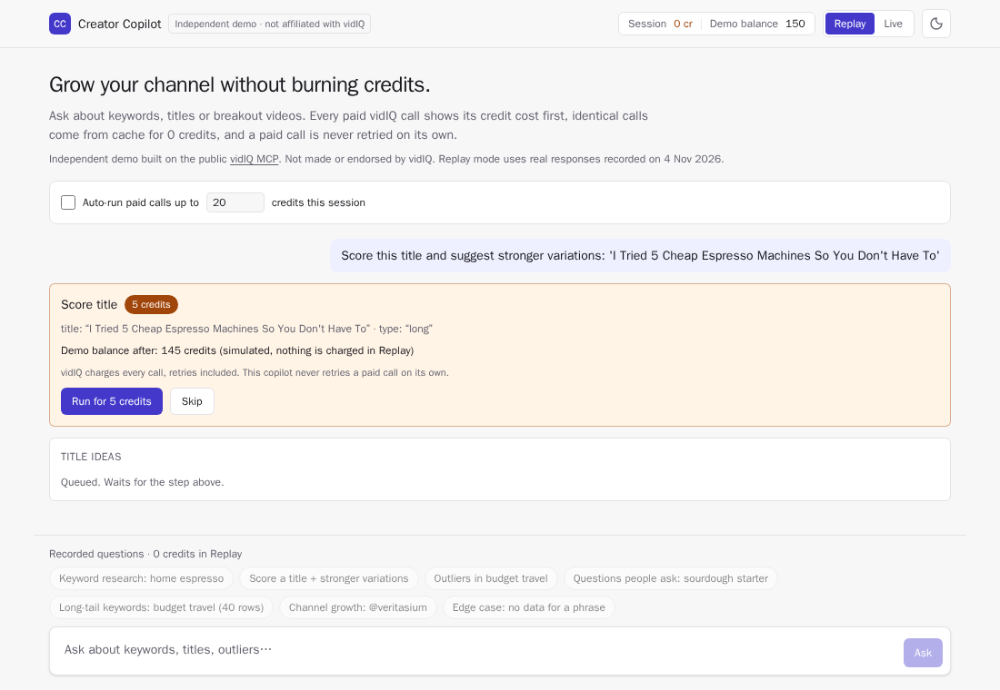
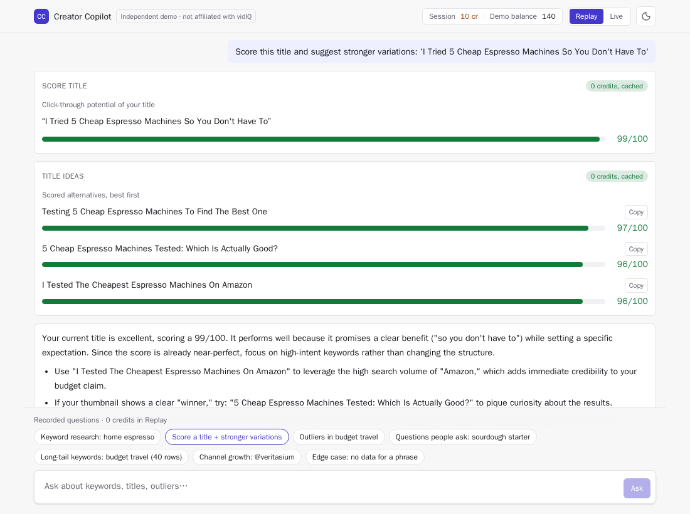
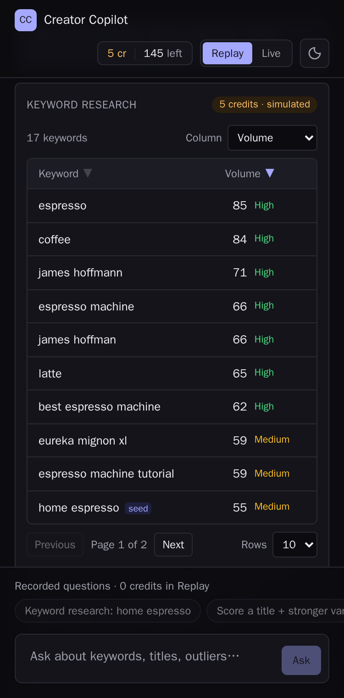

# Creator Copilot — protect creators' credits on the vidIQ MCP

An independent demo built on the public [vidIQ MCP](https://support.vidiq.com/en/articles/15082430-vidiq-mcp).
It is not made or endorsed by vidIQ and uses no vidIQ brand assets.

## Why a creator would want this

vidIQ's own help center for the MCP says:

> "Every generation is charged, including retries and new versions you ask for."
> "Generating the same thing twice costs twice."
> "Before running a big task, ask your AI how many credits it will use."
> — [vidIQ MCP, vidIQ Help Center](https://support.vidiq.com/en/articles/15082430-vidiq-mcp)

A general-purpose AI client does none of this for the creator. It can call the same paid tool
twice, retry a slow call, or score a title it quietly rewrote. Chinh Hoang designed this copilot
around one rule: **a creator never pays for a credit they did not see and approve.**

- **Cost before every paid call.** A cost card shows the tool, the credits and the balance after,
  then waits for *Run* or *Skip*. Creators who trust it can turn on auto-run under a per-session cap.
- **Never pay twice.** Identical calls (same tool, normalised arguments) come from cache and are
  marked **"0 credits, cached"**.
- **Never retry a paid call on its own.** Errors show a manual *Retry for 5 credits* button. Free
  tools may retry once.
- **Read-only allowlist on the server.** Generation, upload, media, bookmark and competitor tools
  are refused by the API route, whatever the model or the browser asks for.
- **The model's arguments are checked before money moves.** While recording the demo data, the
  planner model rewrote the creator's quoted title as *"I Tried 5 Cheap Cheap Espresso Machines…"*.
  A schema check would have passed it, and scoring it would have cost 5 credits for the wrong
  text. A grounding check now requires quoted titles to be copied verbatim; the model is asked once
  to fix its arguments, and an invalid call is blocked, not charged.

| Ask, see the cost first | Repeat question: 0 credits, cached | KeywordTable at 375 px |
|---|---|---|
|  |  |  |

## Run it locally (one command, no keys)

```bash
corepack pnpm install && corepack pnpm demo
```

Open http://localhost:3000. Replay mode is the default: it plays real vidIQ MCP responses and real
model answers recorded on 4 Nov 2026, so the demo costs 0 credits and $0. Node ≥ 22.18; pnpm is
pinned through `packageManager`.

Live mode: set `OPENROUTER_API_KEY` on the server (see `.env.example`), switch to **Live**, and paste
your own vidIQ API key. The key stays in `sessionStorage` (this tab only) and is sent only to this
app's `/api/*` routes, which forward it to `https://mcp.vidiq.com/mcp` as a Bearer token.

## How the job description maps to the code

| JD point | Where it is proven |
|---|---|
| TypeScript | Strict mode with `noUncheckedIndexedAccess`; `pnpm typecheck` is clean. Discriminated unions for results (`src/lib/schemas/view-types.ts`) and errors (`src/lib/mcp/mcp-errors.ts`). |
| React | Function components with no UI library: `src/components/*`. Accessible table (`aria-sort`, row headers), meters, live regions, visible focus. |
| Next.js | App Router 16. Static home page with server-rendered scenario list; route handlers in `src/app/api/*` (plan, tool, answer, balance, telemetry); security headers in `next.config.ts`. |
| Tailwind | Tailwind 4 with CSS-variable design tokens for light and dark (`src/app/globals.css`). No webfonts. |
| Zustand | `src/store/copilot-store.ts` (conversation, settings persisted to localStorage) and `src/store/key-store.ts` (vidIQ key in sessionStorage). Orchestration is outside React in `src/lib/copilot/turn-runner.ts`. |
| Streaming LLM UI | OpenRouter SSE parsed by `src/lib/stream/read-lines.ts` (handles chunk and UTF-8 boundaries), re-streamed as NDJSON by `src/app/api/answer/route.ts`, rendered incrementally and safely (no `innerHTML`) by `src/components/answer-text.tsx`. |
| Unpredictable model output | `parseStructured()` (`src/lib/structured/parse-structured.ts`): ok → local repair → one model repair → typed fallback. Grounding check: `src/lib/llm/grounding.ts`. vidIQ's markdown output parsed and validated row by row: `src/lib/schemas/parse-*.ts`; anything unexpected becomes a `FallbackCard` with the raw text. |
| MCP | Hand-written Streamable HTTP client, protocol 2025-06-18: initialize → `Mcp-Session-Id` → `notifications/initialized` → `tools/call`, JSON or SSE responses, timeouts, error mapping (401/403/402/429/timeout/tool errors). `src/lib/mcp/mcp-client.ts`. |
| Performance | Budget in `perf/budget.json`, enforced by `pnpm perf`. Moving zod validation to the server cut initial JS from 179.5 KB to 147.8 KB. Fixed-size lazy thumbnails, CLS 0. |
| Tests | 76 unit tests at the seams (Vitest) and 6 Playwright tests: the full chat flow in Replay, and the KeywordTable at 375 px. |
| Monitoring | `track()` beacons to `/api/telemetry`, which writes one JSON line per event (tool_call with credits/cached/outcome/ms, plan, answer TTFT, schema_fallback, web vitals, client errors). No prompts or keys are logged. |
| Product sense | Every feature traces back to the credit rules on vidIQ's help center, and to creator tasks: keyword choice, title scoring, finding outliers. |

## Architecture

```
browser (Zustand)                         Next.js route handlers                 external
─────────────────                         ──────────────────────                 ────────
prompt ──► /api/plan ───────────────────► planner (OpenRouter, tool calling) ──► OpenRouter
           ◄─ planned calls (zod + grounding checked, read-only allowlist)
for each call: costOf() + cacheKey()
  cached?      → "0 credits, cached"
  auto-run?    → under the session cap only
  otherwise    → cost card: Run / Skip
Run ─────► /api/tool ───────────────────► allowlist → MCP client ──────────────► mcp.vidiq.com
           ◄─ { result, view }             vidIQ text/JSON → zod → typed view
answer ──► /api/answer (NDJSON stream) ─► OpenRouter stream (Live) / recording (Replay)
```

Replay mode swaps only the two external boxes for recordings in `src/fixtures/replay/`; the rest of
the pipeline is the same code.

## Eval

`pnpm eval` runs offline on the recordings. `pnpm eval --live` calls the real planner and streams
real answers through OpenRouter. Neither runs a vidIQ tool. Latest live run
(`eval/results/latest-live.json`, model `google/gemini-3.1-flash-lite`):

| Metric | Result |
|---|---|
| Tool-choice accuracy | 14 / 14 prompts (100%), including "say hi" and "generate a thumbnail", which must call nothing |
| Schema-valid tool arguments | 100% on the first pass, 100% after repair |
| Time to first token (answer) | median 793 ms, p90 875 ms |
| vidIQ credits used by the eval | 0 (7 calls served from recordings; the other planned calls would cost 30 credits live) |
| LLM cost of the eval run | $0.0088 |
| Malformed-output suite (10 bad outputs) | 3 ok, 4 repaired, 3 typed fallback, 0 crashes |

The set is small on purpose, so it runs in seconds; see the limits below.

## Performance

`pnpm perf` (production build, median of 3 runs, `perf/latest.json`):

| Profile | LCP | CLS | Initial JS (compressed) | Budget |
|---|---|---|---|---|
| Desktop | 92 ms | 0 | 147.8 KB | LCP ≤ 1000 ms, JS ≤ 170 KB |
| Mobile, 375 px, 4× CPU, Slow-4G-like network | 480 ms | 0 | 147.8 KB | LCP ≤ 2500 ms |

## Credits spent building this

The account started at 170 credits. Recording 7 scenarios and one Live-mode smoke test through the
app's own routes brought it to 130 (40 credits). The client counted 45: in the first batch vidIQ
debited 25 where the client counted 30. The client logs the charge vidIQ reports in
`_credits.used` when a tool returns it.

## How it would roll out at vidIQ

1. **Baseline.** Ship only the telemetry events. Measure credits per session, the duplicate-call
   rate (same tool and normalised arguments in one session), retries after errors, and refund
   tickets about unexpected charges.
2. **Shadow.** Run `costOf()` and `cacheKey()` on real traffic without changing the UI. Compare the
   estimate with `_credits.used` and hash results of would-be cache hits. The gate needs estimate
   accuracy ≥ 99% and zero cache hits that returned different data.
3. **Gate.** Turn on the cost card and cache behind a flag for 5% of creators, then 25% and 100%.
   Guardrails: task completion does not drop more than 2 points, credits per completed task fall,
   and tickets about surprise charges fall.
4. **Kill switch.** Separate remote flags for the cost card, the cache and auto-run; a cache-bypass
   path; the server-side allowlist and the daily LLM spend cap stay on regardless.

## What this repo does not prove

- No real users. The flows are tested, but nobody has used them to grow a channel.
- The eval has 14 prompts and one model. It shows the pipeline works; it is not a benchmark.
- Answer grounding is not scored. One recorded answer recommends a title "for the high search
  volume of Amazon", which the data does not say. A real rollout needs a claim check against the
  tool data.
- The markdown parsers depend on vidIQ's current text format for `keyword_research` and
  `outliers`. Drift shows a fallback card instead of a crash, but a production client would use a
  structured contract.
- Perf numbers are from localhost with simulated throttling, not from a CDN in front of real users.
- The public routes have no per-visitor rate limit or bot check, and the LLM spend cap lives in one
  process. A public deploy needs both before it takes traffic.
- The cache is per browser tab (`sessionStorage`), not shared across devices.
- The CI workflow in `.github/workflows/ci.yml` passes `actionlint` but has not run on GitHub yet.

## Development

```bash
corepack pnpm check        # typecheck + 76 unit tests
corepack pnpm e2e          # builds, starts on :3077, runs Playwright (Chromium)
corepack pnpm eval         # offline eval on recordings
corepack pnpm perf         # needs the production server on :3077
corepack pnpm record       # re-record fixtures: spends real credits, hard budget, allowlist only
```

Chinh set the seams before any code, and each was built test-first (red, then green), with AI
coding tools used for parts of the implementation under review. The end-to-end tests were checked
by breaking the cache on purpose and watching them fail. Files stay under 200 lines.

```
src/app/            page, layout, API route handlers
src/components/     UI, including results/ (KeywordTable, TitleScoreCard, OutlierGrid, ChannelCard)
src/lib/credits/    costOf, decideRun
src/lib/cache/      cacheKey, ToolCache
src/lib/mcp/        MCP client, JSON-RPC/SSE reader, error mapping
src/lib/llm/        planner, grounding, OpenRouter client, spend guard
src/lib/schemas/    vidIQ output → typed views
src/lib/replay/     recordings, matcher, sanitiser
scripts/            record-fixtures, eval, perf
e2e/                Playwright specs
```
